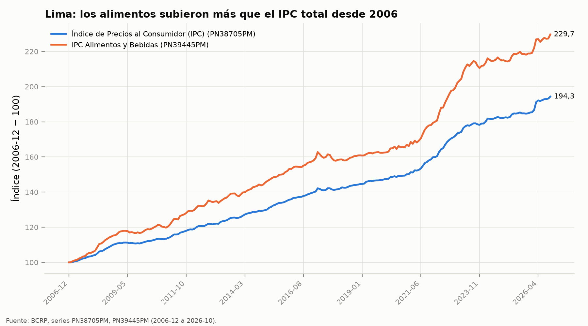
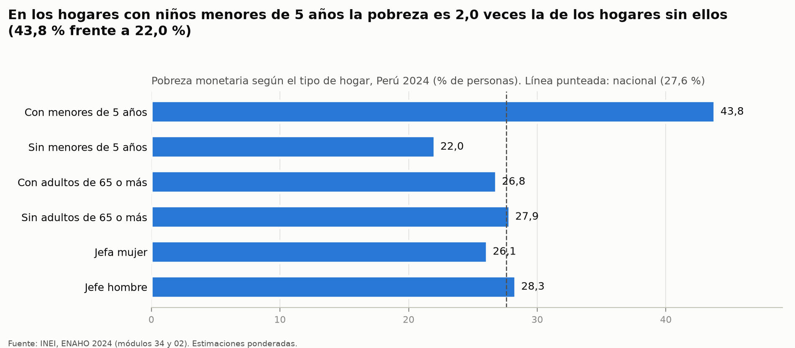
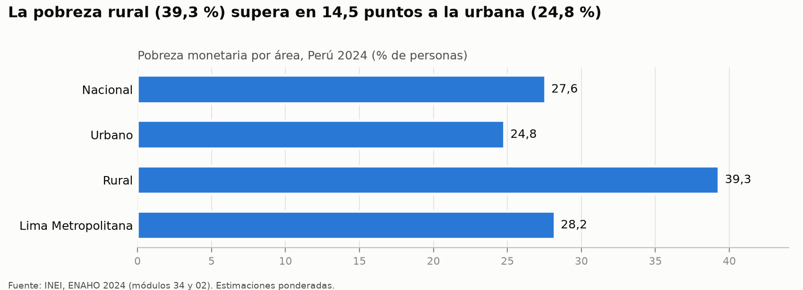
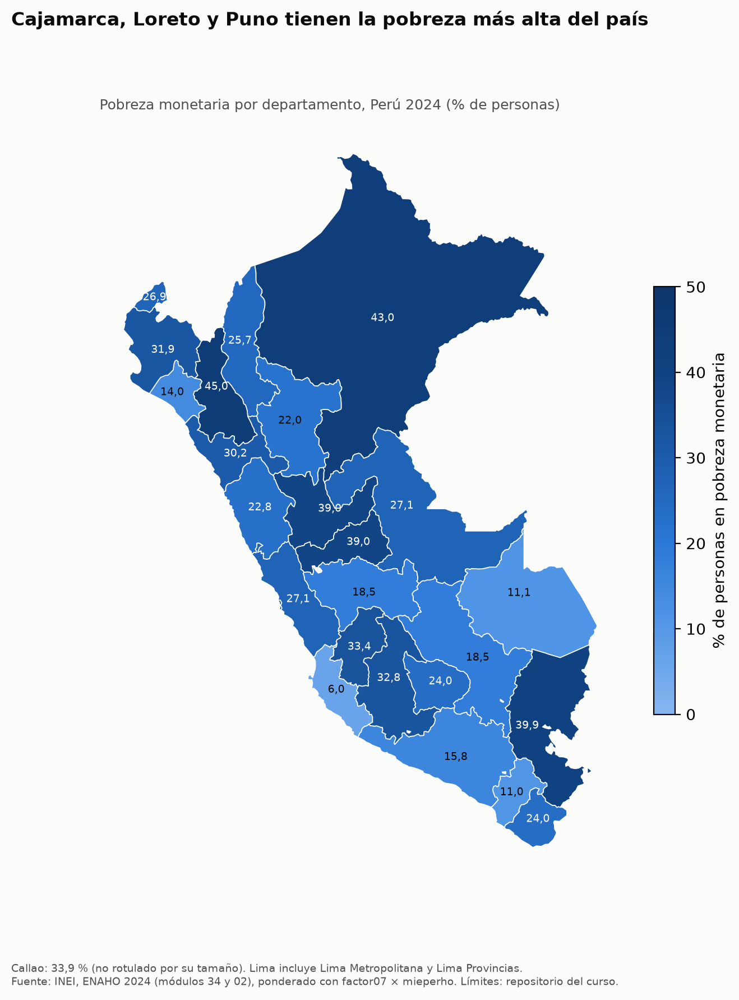

# ¿A quién protege hoy la política social en el Perú?

**Precios, poder de compra de Juntos y pobreza monetaria: BCRP 2006-2026 y ENAHO 2024**

Informe generado por el agente de investigación socioeconómica de `tarea_4` (servidor MCP `bcrp` y Skills
`limpiando-enaho`, `graficando-enaho` y `mapeando-enaho`), 8 de noviembre de 2026. Todas las cifras salen de una
herramienta; las del DT 309 solo se usan para contrastar (sección 8).

---

## 1. Pregunta de investigación

**Tema.** La protección que ofrece la política social peruana, con el programa Juntos como caso: cuánto vale hoy su
transferencia, cómo han subido los precios que más pesan en el presupuesto de los hogares pobres y dónde están esos
hogares.

**Objetivo.** Responder a tres preguntas con datos oficiales y de forma reproducible:

1. ¿Cuánto poder de compra perdieron los S/ 100 mensuales de Juntos entre diciembre de 2006 y 2026?
2. ¿Cuánto subieron los alimentos frente al resto de precios y cuánto pesa eso en el costo de vida de un hogar pobre?
3. ¿En qué territorios y en qué tipos de hogar se concentra la pobreza monetaria en 2024, y a cuántos de esos hogares
   llega Juntos?

**Delimitación.**

- **Precios:** IPC de Lima Metropolitana (BCRP), de diciembre de 2006 a octubre de 2026, el último mes disponible al
  consultar.
- **Pobreza:** ENAHO 2024 del INEI (módulo 34 «sumaria» y módulo 02 «miembros del hogar»), nacional, por área, por
  departamento (25) y por tipo de hogar.
- **Marco:** Trivelli y Mendoza (2026), «Repensar y rearmar la política social para retomar la senda perdida», IEP,
  Documento de Trabajo 309.

## 2. Fuentes y metodología

### 2.1 Datos

| Fuente | Contenido | Acceso |
|---|---|---|
| BCRP, series estadísticas | IPC y variaciones de Lima Metropolitana | servidor MCP `bcrp` (API `estadisticas.bcrp.gob.pe`) |
| INEI, ENAHO 2024, módulo 34 | sumaria: gasto, líneas, pobreza, transferencias (33 691 hogares) | `datos/966-Modulo34.zip` |
| INEI, ENAHO 2024, módulo 02 | miembros del hogar: edad, sexo, parentesco, residencia (117 721 filas) | `datos/966-Modulo02.zip` |
| Repositorio del curso | límites departamentales (GeoJSON) y referencia departamental de la sesión 16 | `datos/`, `referencias/` |
| Trivelli y Mendoza (2026) | cifras publicadas, con fuente original y página | `referencias/contraste_dt309.csv` |

### 2.2 Series del BCRP (ubicadas con `buscar_series`)

| Código | Serie (Lima Metropolitana) | Uso |
|---|---|---|
| `PN38705PM` | IPC, índice dic. 2021 = 100 | poder de compra de Juntos (`valor_real`), gráfico |
| `PN39445PM` | IPC Alimentos y Bebidas, índice dic. 2021 = 100 | alza de alimentos, gráfico, Juntos en precios de alimentos |
| `PN38706PM` | IPC sin Alimentos y Bebidas, índice dic. 2021 = 100 | «resto de precios» |
| `PN01273PM` | IPC, variación % 12 meses | inflación total |
| `PN09822PM` | IPC Alimentos y Bebidas, variación % 12 meses | inflación de alimentos (cruce) |
| `PN09823PM` | IPC sin Alimentos y Bebidas, variación % 12 meses | inflación del resto (cruce complementario) |

### 2.3 Procesamiento de la ENAHO (Skill `limpiando-enaho`)

- Llaves de hogar y persona como texto; nombres de variables en minúscula.
- Residentes habituales: `((p204 == 1) & (p205 == 2)) | ((p204 == 2) & (p206 == 1))` (108 664 personas).
- Unión personas–hogares `merge(validate="m:1")`: 108 664 personas antes y después, ninguna sin hogar.
- Pobre si `pobreza <= 2` y pobre extremo si `pobreza == 1`. Urbano si `estrato <= 5`. Departamento = `ubigeo[:2]`,
  con Lima (15) y Callao (07) separados. Lima Metropolitana = `dominio == 8`, que incluye el Callao.
- Participación de los alimentos = suma de `gru1*` / `gashog2d`. Juntos = `ingtpu01` (soles al año).
- **Ponderación:** los indicadores de hogar usan `factor07 × mieperho`, que da la tasa en personas (método del INEI).
  Los de persona (sexo) usan `facpob07`. Los conteos de hogares usan `factor07`. No hay promedios simples, salvo la
  mediana del monto de Juntos, que se calcula sin ponderar; la mediana ponderada con `factor07` da el mismo valor.
- **Validación** (`salidas/validacion.txt`): **VÁLIDA**, con 15 de 16 pruebas aprobadas. Hay un aviso no
  esencial: 19 hogares (0,06 %) gastan en alimentos más que su gasto total, y se dejan como están. La pobreza
  nacional sale 27,58 %, la urbana 24,81 % y la rural 39,30 %. Por departamento, la diferencia máxima con la
  referencia de la sesión 16 es 0,05 pp.

### 2.4 Indicadores y cálculos

| Indicador | Cálculo | Herramienta |
|---|---|---|
| Valor real de Juntos | `monto × IPC[dic-2006] / IPC[mes]` | MCP `valor_real` |
| Variación acumulada y precio relativo de alimentos | cociente de índices 2006-12 → 2026-10 | MCP `resumen` + `scripts/cruce_y_contraste.py` |
| Pobreza, pobreza extrema, brecha FGT1, distribución de los pobres, gasto en alimentos, Juntos | ponderados según 2.3 | Skill `limpiando-enaho` → `salidas/indicadores.csv` |
| Aporte de los alimentos al alza del costo de vida | participación de los alimentos en el gasto × `PN09822PM` de 2026-10 | `scripts/cruce_y_contraste.py` |
| Cobertura de Juntos | % de personas (`peso_personas`) en hogares con `ingtpu01 > 0` | `scripts/cruce_y_contraste.py` sobre `salidas/hogares_2024.parquet` |

## 3. Resultados

### Hallazgo 1. Los S/ 100 de Juntos valen hoy la mitad que en 2006, y menos de la mitad si se miden en alimentos

- El IPC de Lima subió **94,3 %** entre diciembre de 2006 y octubre de 2026: de 62,56 a 121,55
  (`PN38705PM`, `resumen` 2006-12 a 2026-10). El valor más alto de la serie es el último dato.
- **S/ 100 de agosto de 2026 equivalen a S/ 51,82 de diciembre de 2006**, y S/ 100 de octubre de 2026 equivalen a
  **S/ 51,47** (`valor_real`, `PN38705PM`). Con un monto nominal fijo de S/ 100, la transferencia perdió
  **48,2 %** de su poder de compra hasta agosto de 2026 y **48,5 %** hasta octubre de 2026
  (`salidas/cruce.csv`).
- Medidos en precios de alimentos, los S/ 100 de octubre de 2026 equivalen a **S/ 43,53** de diciembre de 2006, una
  pérdida de **56,5 %** (`valor_real` con `PN39445PM`).
- La ENAHO 2024 confirma que el monto nominal sigue cerca de S/ 100. La mediana anual de Juntos entre los hogares
  receptores es **S/ 1 202**, es decir **S/ 100,17 al mes**, y el 90 % central de los montos declarados va de
  S/ 1 192 a S/ 1 218 al año (ENAHO 2024, `monto_anual_mediano`/Juntos; percentiles en `salidas/cruce.csv`).
  En soles de diciembre de 2006, esa mediana **equivale a S/ 54,88**, con el IPC de diciembre de 2024
  (`valor_real`, `PN38705PM`, 2024-12 → 2006-12; inflación acumulada de 82,5 %).

### Hallazgo 2. Los alimentos subieron mucho más que el resto de precios, y pesan más en el gasto de los pobres

- Entre 2006-12 y 2026-10, el IPC de Alimentos y Bebidas subió **129,7 %**, de 55,74 a 128,04 (`PN39445PM`,
  `resumen`). El IPC sin alimentos subió **71,4 %**, de 68,39 a 117,23 (`PN38706PM`, `resumen`). Por eso los
  alimentos se encarecieron **34,0 %** frente al resto de precios (`salidas/cruce.csv`).
- Inflación a 12 meses:
  - IPC total (`PN01273PM`, 2007-01 a 2026-10): promedio de 3,30 %, máximo de 8,81 % (2022-06) y último dato de
    **5,25 %** (2026-10).
  - Alimentos (`PN09822PM`, mismo periodo): promedio de 4,19 %, máximo de 13,16 % (2023-02), mínimo de −2,57 %
    (2018-03) y último dato de **5,28 %** (2026-10).
  - Entre 2024-01 y 2026-10, ambas series llegan a su máximo en octubre de 2026. El IPC total tuvo su mínimo en
    1,11 % (2025-08) y el de alimentos en 0,59 % (2025-03).
  - En diciembre de 2024, el mes del IPC usado en el cruce, la inflación a 12 meses fue de 1,97 % la total y de
    1,25 % la de alimentos.
- Los hogares pobres destinan **44,6 %** de su gasto a alimentos y los no pobres, **33,2 %** (ENAHO 2024,
  `share_gasto_alimentos`, promedio ponderado).
- **Cruce:** participación de alimentos de los pobres (44,63 %) × inflación de alimentos a 12 meses de octubre de
  2026 (5,28 %, `PN09822PM`) = **2,36 puntos porcentuales**. Eso es lo que los alimentos aportan al alza anual del
  costo de vida de un hogar pobre. En un hogar no pobre aportan 1,75 pp.
- Si se suma el resto de la canasta con la inflación sin alimentos (5,23 %, `PN09823PM`, 2026-10), el alza
  implícita es de 5,25 % para pobres y no pobres. Para los pobres, los alimentos explican **44,9 %** de esa alza;
  para los no pobres, 33,4 %. En el último año los dos grupos de precios subieron casi igual, así que el peso de los
  alimentos casi no cambia el total.
- La diferencia aparece en el largo plazo. Con la canasta de 2024 fija, el alza acumulada 2006-2026 es de
  **97,4 %** para un hogar pobre y de **90,7 %** para uno no pobre. Para los pobres, los alimentos explican 59,4 % de
  esa alza (`salidas/cruce.csv`; es una aproximación, ver Limitaciones).

### Hallazgo 3. La pobreza es más alta en el campo, en los hogares con niños pequeños y en el norte y la Amazonía; pero la mayoría de los pobres es urbana

- **Nivel.** En 2024, **27,58 %** de las personas son pobres, unos **9,51 millones**, y **5,50 %** son pobres
  extremas. Además, **31,80 %** son no pobres pero vulnerables (ENAHO 2024: `pobreza`/Nacional, `pobres`,
  `pobreza_extrema`, `condicion_vulnerabilidad`).
- **Área.** La pobreza es de **39,30 %** en el área rural y de **24,81 %** en la urbana. La pobreza extrema también
  es mucho mayor en el campo: 15,52 % frente a 3,14 %. Aun así, **72,7 % de los pobres vive en zonas urbanas** y **33,9 % en Lima
  Metropolitana** (con el Callao), donde la pobreza es de 28,21 %, algo más que el promedio nacional (ENAHO 2024,
  `pobreza` y `distribucion_pobres`).
- **Tipo de hogar.**
  - En los hogares con **menores de 5 años**, la pobreza es de **43,80 %**, frente a 22,03 % en los hogares sin
    ellos. La pobreza extrema es de 10,29 %, frente a 3,87 %. El 40,5 % de los pobres vive en estos hogares.
  - Con adultos de 65 o más años la diferencia es pequeña: 26,82 % frente a 27,85 %.
  - Por jefatura, la pobreza es de 26,11 % con jefa mujer y de 28,32 % con jefe hombre. En el área rural es de
    35,19 % y 40,57 %, respectivamente.
  - Por sexo de la persona, la pobreza es de 27,68 % en mujeres y 27,37 % en hombres (con `facpob07`).
- **Territorio.**
  - Más pobreza: **Cajamarca (45,01 %)**, **Loreto (42,97 %)**, Puno (39,94 %), Pasco (38,97 %) y Huánuco (38,96 %).
  - Menos pobreza: Ica (6,01 %), Moquegua (10,97 %), Madre de Dios (11,15 %), Lambayeque (14,04 %) y Arequipa
    (15,78 %).
  - El Callao llega a 33,86 % y el departamento de Lima, que incluye Lima Provincias, a 27,07 % (ENAHO 2024,
    `pobreza_departamento`).
- **Brecha de pobreza.** La brecha (FGT1) es de **7,21 %** de la línea. La línea de pobreza promedio es de
  S/ 454,39 por persona al mes y la de pobreza extrema, de S/ 255,57.

### Hallazgo 4 (complementario). Juntos llega a la mitad de los pobres rurales, pero a solo 15 % de los pobres urbanos

Estimación propia con `salidas/hogares_2024.parquet`, ponderada con `factor07 × mieperho`.

- La ENAHO estima **1 040,8 mil hogares** con Juntos (`hogares_receptores`, `factor07`).
- **24,3 % de las personas pobres** vive en un hogar que recibe Juntos.
- Por grupo:

| Grupo | % que vive en un hogar con Juntos |
|---|---|
| Pobres extremos | 38,1 % |
| Pobres con menores de 5 años | 31,9 % |
| Pobres rurales | 48,7 % |
| Pobres urbanos | 15,1 % |
| No pobres | 9,5 % |

- De las personas en hogares con Juntos, **49,2 % son pobres** según la línea monetaria de 2024.

## 4. Visualizaciones



**Figura 1.** Desde diciembre de 2006, los alimentos (229,7) se separan del IPC total (194,3), sobre todo desde
2021. La transferencia nominal de Juntos no siguió a ninguna de las dos curvas. Fuente: BCRP, `PN38705PM` y
`PN39445PM`, 2006-12 a 2026-10 (`graficar_serie`, base 100).



**Figura 2.** Tener niños menores de 5 años es el rasgo del hogar más asociado a la pobreza: 43,8 % frente a 22,0 %.
La presencia de adultos mayores o el sexo de quien encabeza el hogar marcan poca diferencia. Fuente: INEI, ENAHO
2024 (Skill `graficando-enaho`, `hogares`).



**Figura 3.** La pobreza rural (39,3 %) supera a la urbana (24,8 %), y Lima Metropolitana (28,2 %) está por encima
del promedio nacional (27,6 %). Fuente: INEI, ENAHO 2024 (Skill `graficando-enaho`, `area`).



**Figura 4.** La pobreza se concentra en la sierra norte (Cajamarca, 45,0 %), la Amazonía (Loreto, 43,0 %) y el
altiplano (Puno, 39,9 %). La costa sur (Ica, Moquegua, Arequipa) tiene las tasas más bajas. Fuente: INEI, ENAHO 2024
(Skill `mapeando-enaho`; 25 departamentos unidos por código de ubigeo).

## 5. Interpretación

Los resultados describen asociaciones, no causas.

1. **La protección se ha encogido en términos reales.** El monto nominal de Juntos se mantiene en torno a S/ 100 al
   mes: lo dice la ENAHO 2024 y es el supuesto del enunciado y del DT 309. Mientras tanto, el IPC subió 94,3 % y los
   alimentos 129,7 %. Para un hogar pobre, con su canasta de 2024 fija (45 % en comida), los S/ 100 de octubre de
   2026 valen **S/ 50,65 de 2006** (`salidas/cruce.csv`). Es un poco menos que con el IPC general (S/ 51,47) y está
   lejos de la medida solo con alimentos (S/ 43,53), porque el 55 % restante de su gasto subió menos. *(Corregido en
   la verificación, sección 9: la primera versión decía que se parecía más a la medida con alimentos.)*
2. **Los pobres están más expuestos a los alimentos.** Por cada punto de inflación de alimentos, el costo de vida de
   un hogar pobre sube unos 0,45 puntos, y el de uno no pobre, unos 0,33. En el último año eso apenas importó,
   porque los alimentos y el resto subieron casi lo mismo (5,28 % y 5,23 %). En los veinte años acumulados sí
   importa: con canasta fija, el alza es de 97,4 % para los pobres y de 90,7 % para los no pobres.
3. **Dónde está la pobreza depende de cómo se mire.** Por tasa, el problema es rural, amazónico y andino. Por
   número de personas, es urbano: siete de cada diez pobres viven en ciudades y uno de cada tres en Lima
   Metropolitana.
4. **¿A quién protege Juntos?** Su presencia está asociada a lo rural y a la pobreza extrema: llega a casi la mitad
   de los pobres rurales y a 38 % de los pobres extremos. En cambio, llega a solo 15 % de los pobres urbanos, que
   son la mayoría de los pobres. También llega a menos de un tercio de los pobres con niños pequeños, el tipo de
   hogar con más pobreza.
5. **Focalización.** Que la mitad de las personas en hogares con Juntos no sea pobre en 2024 no prueba que el
   programa esté mal focalizado. La focalización del programa no usa la línea monetaria de la ENAHO de ese año, y
   el propio ingreso de Juntos puede sacar a algunos hogares de la línea. Pero sí muestra que la medición monetaria
   anual y el padrón no coinciden.

## 6. Limitaciones

- **Cobertura temporal.** La pobreza es de 2024 y los precios llegan a octubre de 2026. El cruce mezcla la canasta
  de gasto de 2024 con la inflación de 2026: supone que la participación de los alimentos no cambió. La cobertura de
  Juntos y la pobreza pueden haber cambiado desde 2024. El DT 309 cita otra cifra de pobreza para 2025, que aquí no
  se puede verificar.
- **Niveles de agregación distintos.**
  - El IPC es de Lima Metropolitana y se aplica a hogares de todo el país, incluidos los rurales, cuyos precios
    pueden moverse distinto. Las líneas de pobreza de la ENAHO, en cambio, varían por dominio.
  - El rubro «Alimentos y Bebidas» del IPC y el grupo 1 de gasto de la ENAHO (`gru1*`) no tienen necesariamente la
    misma cobertura.
  - «Lima Metropolitana» (`dominio == 8`, con el Callao) no es lo mismo que el departamento de Lima (ubigeo 15, con
    Lima Provincias y sin el Callao). Por eso hay tres cifras distintas: 28,21 %, 27,07 % y 33,86 % (Callao).
  - Juntos es una transferencia al hogar. Su cobertura se mide aquí como el porcentaje de personas que viven en
    hogares receptores, no como el porcentaje de personas elegibles.
- **El cálculo con canasta fija 2006-2026** es una aproximación de tipo Laspeyres con la participación de 2024. No
  es un índice de precios de los pobres.
- **Calidad de los datos.**
  - 19 hogares gastan en alimentos más que su gasto total. Se avisa en la validación y se dejan como están.
  - El monto y la recepción de Juntos son autodeclarados. La ENAHO estima 1,04 millones de hogares receptores, 37 %
    más que el padrón citado en el DT 309 (sección 8).
  - No se calcularon errores estándar ni intervalos de confianza, porque no se usó el diseño muestral (estratos y
    conglomerados). Las cifras departamentales y por subgrupo tienen más error que las nacionales.
  - La mediana de Juntos de `indicadores.csv` es sin ponderar. La ponderada con `factor07` da lo mismo (S/ 1 202).
- **Lo que no se puede medir con los módulos 34 y 02:**
  - inseguridad alimentaria (FIES, que empezó en 2025);
  - educación, lengua materna, empleo e informalidad, vivienda y servicios (módulos 100, 300 y 500, no usados);
  - salud y nutrición infantil;
  - elegibilidad o clasificación socioeconómica para Juntos y cumplimiento de corresponsabilidades;
  - el efecto causal de Juntos sobre la pobreza (no hay contrafactual);
  - la pobreza «sin transferencias», que exige una simulación;
  - la evolución de la pobreza en 2019 o 2025 (solo hay ENAHO 2024).
- **Alcance.** Es un análisis descriptivo con un año de encuesta. No evalúa el programa ni identifica causas.
- **Incidencias con las herramientas.** No hubo errores de datos. El primer `graficar_serie` dejó cortados el título
  y la nota al pie, porque la nota repetía la fuente que la herramienta ya añade; el gráfico se regeneró con un
  título más corto y sin nota extra. El script de cruce falló una vez al imprimir «→» en la consola de Windows
  (cp1252); se corrigió con `sys.stdout.reconfigure(encoding="utf-8")`.

## 7. Reproducibilidad

```bash
cd tarea_4
uv sync
uv run python scripts/descargar_datos.py                               # ENAHO 2024 (módulos 34 y 02) y GeoJSON
uv run python .claude/skills/limpiando-enaho/scripts/limpiar.py        # Skill limpiando-enaho
uv run python .claude/skills/graficando-enaho/scripts/graficar.py area     # Skill graficando-enaho
uv run python .claude/skills/graficando-enaho/scripts/graficar.py hogares
uv run python .claude/skills/mapeando-enaho/scripts/mapear.py          # Skill mapeando-enaho
uv run python scripts/cruce_y_contraste.py                             # cruce BCRP × ENAHO y contraste DT 309
```

**Llamadas al MCP `bcrp`, en orden:**

| Herramienta | Argumentos |
|---|---|
| `buscar_series` | «ipc lima metropolitana indice», «ipc alimentos y bebidas», «ipc 12 meses», «Dic.2021 = 100 IPC» (Mensual) |
| `resumen` | `PN38705PM`, `PN39445PM` y `PN38706PM` (2006-12 a 2026-10); `PN01273PM` y `PN09822PM` (2007-01 a 2026-10 y 2024-01 a 2026-10); `PN38705PM` y `PN39445PM` (2024-12 a 2026-10) |
| `serie` | `PN09823PM` 2026-10; `PN09822PM` y `PN01273PM` 2024-12 |
| `valor_real` | (100, 2026-08 → 2006-12); (100, 2026-10 → 2006-12); (100, 2026-10 → 2006-12, `PN39445PM`); (100,1667, 2024-12 → 2006-12) |
| `graficar_serie` | [`PN38705PM`, `PN39445PM`], 2006-12 a 2026-10, `base_100=True`, archivo `bcrp_ipc_alimentos.png` |

`scripts/cruce_y_contraste.py` vuelve a pedir esos valores al servidor MCP (`serie` y `valor_real`) en cada
ejecución. La versión que escribió el agente los tenía copiados como constantes; se cambió en la verificación y la
salida es idéntica (sección 9).

**Archivos de salida:**

| Tipo | Archivos |
|---|---|
| Validación e indicadores | `salidas/validacion.txt`, `salidas/indicadores.csv` |
| Bases limpias | `salidas/hogares_2024.parquet`, `salidas/personas_2024.parquet` |
| Cruce y contraste | `salidas/cruce.csv`, `salidas/contraste_dt309_resultado.csv` |
| Comparación del mapa | `salidas/comparacion_mapa.csv` |
| Figuras | `figuras/bcrp_ipc_alimentos.png`, `figuras/enaho_pobreza_area.png`, `figuras/enaho_pobreza_hogares.png` |
| Mapa | `mapas/pobreza_departamento_2024.png` |

**Series usadas:** `PN38705PM`, `PN39445PM`, `PN38706PM`, `PN01273PM`, `PN09822PM` y `PN09823PM`. Fuente:
`https://estadisticas.bcrp.gob.pe/estadisticas/series/api/<código>/json/<desde>/<hasta>`.

## 8. Contraste con cifras publicadas

Cifras publicadas: Trivelli y Mendoza (2026), DT IEP 309, según `referencias/contraste_dt309.csv`. Cálculo de la
tabla: `salidas/contraste_dt309_resultado.csv`. Diferencia = cifra del informe − cifra publicada.

| Cifra | Informe | Publicada | Fuente publicada (página) | Diferencia |
|---|---|---|---|---|
| Pobreza nacional 2024 (%) | 27,579 | 27,6 | INEI (2026a); DT 309, p. 9 | −0,021 pp |
| Pobreza urbana 2024 (%) | 24,807 | 24,8 | INEI (2026a); DT 309, p. 11 | +0,007 pp |
| Pobreza rural 2024 (%) | 39,303 | 39,3 | INEI (2026a); DT 309, p. 11 | +0,003 pp |
| Pobreza extrema nacional 2024 (%) | 5,505 | 5,5 | INEI (2026a); DT 309, p. 11 | +0,005 pp |
| Pobreza extrema rural 2024 (%) | 15,518 | 15,5 | INEI (2026a); DT 309, p. 11 | +0,018 pp |
| Pobreza extrema Lima Metropolitana 2024 (%) | 3,285 | 3,3 | INEI (2026a); DT 309, p. 11 | −0,015 pp |
| Brecha de pobreza FGT1 2024 (% de la línea) | 7,207 | 7,21 | ENAHO, procesamiento de las autoras; DT 309, Tabla A1, p. 66 | −0,003 |
| IPC Lima dic-2006 (dic. 2021 = 100) | 62,557 | 62,56 | INEI (IPC Lima); DT 309, Anexo 2, p. 67 | −0,003 |
| IPC Lima ago-2026 (dic. 2021 = 100) | 120,716 | 120,72 | INEI (IPC Lima); DT 309, Anexo 2, p. 67 | −0,004 |
| S/ 100 de Juntos (ago-2026) en soles de dic-2006 | 51,822 | 51,82 | Cálculo de las autoras con IPC Lima; DT 309, Anexo 2, p. 67 | +0,002 |
| Hogares con Juntos (miles) | 1 040,8 (2024, ENAHO) | 760 (2026, padrón) | InfoMidis, 5-oct-2026; DT 309, p. 42 | +280,8 (+36,9 %), **no comparable** |
| No pobre vulnerable (%) | 31,80 (2024) | 32,8 (2025) | INEI (2026a); DT 309, p. 15 | −1,00 pp, **año distinto** |
| Línea extrema / canasta básica alimentaria (S/ por persona al mes) | 255,57 (2024) | 260 (2025); 187 (2019) | INEI (2026a); DT 309, p. 11 | −4,43 frente a 2025, **año distinto** |

**Lectura del contraste.**

- **Las cifras de pobreza 2024 cuadran.** Todas las diferencias son menores de 0,03 pp (la mayor es −0,021 pp), lo
  que corresponde al redondeo a un decimal del documento. La fuente es la misma: los microdatos del INEI. La pobreza nacional
  calculada por personas (`facpob07`) da 27,53 %, también dentro del redondeo.
- **El IPC y el valor real de Juntos cuadran exactamente.** Las diferencias de milésimas son redondeo. El MCP
  reproduce los S/ 51,82 del Anexo 2 del DT 309.
- **Los hogares con Juntos no cuadran.** La ENAHO 2024 da 1,04 millones de hogares y el padrón de octubre de 2026,
  760 mil. Las posibles razones:
  1. año distinto: 2024 frente a 2026;
  2. fuente distinta: encuesta autodeclarada frente a registro administrativo;
  3. la encuesta capta a los hogares que declaran haber recibido la transferencia en su periodo de referencia,
     aunque luego hayan salido del programa;
  4. error muestral del factor de expansión.

  Con estos datos no se puede decidir cuál de estas razones pesa más.
- **No pobre vulnerable y canasta.** Los años no coinciden (2024 frente a 2025), así que la diferencia no valida ni
  invalida nada. La línea extrema de 2024 (S/ 255,57) queda entre la canasta de 2019 (S/ 187) y la de 2025
  (S/ 260), como se esperaría con precios al alza.
- **Cifras del DT 309 que no se pueden replicar aquí:**
  - pobreza de 2019 (20,2 %) y de 2025 (25,7 %): no hay ENAHO de esos años en el proyecto;
  - pobreza sin Juntos ni Pensión 65 (29,6 %, CIES 2025): requiere una simulación;
  - inseguridad alimentaria (FIES 2025): el módulo no existe en 2024 ni está en los módulos 34 y 02.
- **Comparación cualitativa (indicadores y años distintos).**
  - Por presencia de menores de 5 años, el DT 309 muestra más inseguridad alimentaria en esos hogares (34,2 % frente
    a 29,3 %, 2025). Va en la misma dirección que la pobreza monetaria de este informe (43,8 % frente a 22,0 %,
    2024).
  - Por jefatura no ocurre lo mismo. En el DT 309, la inseguridad alimentaria es mayor con jefa mujer (34,9 % frente
    a 28,1 %), mientras que aquí la pobreza monetaria es algo menor (26,1 % frente a 28,3 %). No es una
    contradicción: miden cosas distintas, en años distintos.

## 9. Verificación manual de cifras

Esta sección se agregó **después** de la ejecución del agente. Cada afirmación se comprobó por un camino distinto
del que usó el agente.

| # | Afirmación del informe | Valor del informe | Verificación (fuente o procedimiento) | Valor verificado | ¿Coincide? |
|---|---|---|---|---|---|
| 1 | IPC Lima dic-2006 y ago-2026 (`PN38705PM`) | 62,557 y 120,716 | Página web del BCRP (no la API): `estadisticas.bcrp.gob.pe/estadisticas/series/mensuales/resultados/PN38705PM/html/2006-12/2006-12/` y `.../2026-08/2026-08/`; DT 309, Anexo 2 | 62,56 y 120,72 | Sí (redondeo) |
| 2 | S/ 100 de ago-2026 = S/ 51,82 de dic-2006 | 51,822 | Con los dos valores de la fila 1: 100 × 62,56 / 120,72 = 51,82; el DT 309 (Anexo 2) da 51,82 | 51,82 | Sí |
| 3 | Inflación a 12 meses oct-2026: total 5,25 % y alimentos 5,28 % | 5,251 y 5,284 | Página web del BCRP para `PN01273PM` y `PN09822PM`, Oct26 | 5,25 y 5,28 | Sí |
| 4 | Pobreza nacional 2024: 27,58 % | 27,579 | Informe del INEI (27,6 %, citado en el DT 309, p. 9) y `evaluacion/verificacion_independiente.py`, que lee el `.dta` sin la Skill | 27,6 y 27,579 | Sí (−0,02 pp) |
| 5 | Pobreza extrema rural 2024: 15,52 % | 15,518 | INEI (15,5 %, DT 309, p. 11) y cálculo independiente | 15,5 y 15,518 | Sí |
| 6 | 72,7 % de los pobres vive en zonas urbanas | 72,74 | Cálculo independiente (`verificacion_independiente.py`); no hay cifra publicada para 2024 | 72,744 | Sí |
| 7 | Mediana de Juntos en la ENAHO = S/ 54,88 de 2006 al mes | 54,883 | Cálculo independiente: mediana de `ingtpu01` (1 202) / 12 × IPC dic-2006 / IPC dic-2024 | 54,883 | Sí |
| 8 | Cajamarca, el departamento más pobre, con 45,01 % | 45,007 | Referencia de la sesión 16 (`referencias/pobreza_departamento_2024.csv`) y cálculo independiente | 45,0 y 45,007 | Sí |
| 9 | «Para un hogar pobre el deterioro se parece más al medido con precios de alimentos» (primera versión de la interpretación 1) | S/ 43,53 | Se recalculó con la canasta de los pobres: 100 / (1 + 0,974) | S/ 50,65 | **No:** se corrigió el texto |

**Errores y correcciones encontrados en la verificación:**

- La interpretación 1 sacaba una conclusión que sus propias cifras no sostenían (fila 9); el texto se corrigió.
- El script del agente tenía copiados a mano los valores del BCRP. Ahora los pide al MCP en cada ejecución, con el
  mismo resultado.
- El primer gráfico del BCRP salió con el título cortado. El agente lo regeneró, y además se corrigió la
  herramienta `graficar_serie`, que ahora parte los títulos largos.
- No se encontraron cifras inventadas: cada número del informe está en `salidas/indicadores.csv`,
  `salidas/cruce.csv`, `salidas/contraste_dt309_resultado.csv` o en una llamada al MCP registrada en
  `evidencias_ia/integracion/ejecucion_agente.md`.

---

### Herramientas usadas

- **MCP `bcrp`:** `buscar_series` (4 búsquedas), `resumen` (9 llamadas), `serie` (3), `valor_real` (4) y
  `graficar_serie` (2: la segunda corrigió el título).
- **Skills:**
  - `limpiando-enaho`: limpieza, validación **VÁLIDA** e `indicadores.csv`.
  - `graficando-enaho`: `area` y `hogares`.
  - `mapeando-enaho`: mapa departamental, 25 de 25 departamentos, diferencia máxima con la referencia de 0,05 pp.
- **Script propio:** `scripts/cruce_y_contraste.py`, para el cruce y el contraste en Python, sin cuentas a mano.
